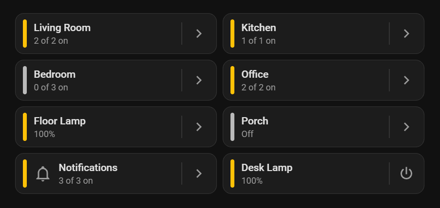

# Split Tile Card for Home Assistant

A dashboard tile split in two: tap it to turn a room's lights on or off, and tap the chevron to open the room's view, a light's brightness slider or a pop-up of other cards.



- **Two actions per tile:** the large part toggles, and the chevron opens more, so a whole room is one tap to switch and one tap to explore.
- **Room tiles:** show how many lights are on, such as "2 of 3 on", turn the room on at full brightness and open the room's own view.
- **Light tiles:** show the brightness, bring the light back at its last level and open the more-info dialog with its slider.
- **Pop-up tiles:** open a pop-up holding any other cards, such as the scripts behind a group of switches.
- **A state bar, not an icon:** a coloured bar down the left edge shows on, off and unavailable, so tiles stay compact and need no icons.
- **Swap mode:** put opening on the tap and a power button on the right, if you open more often than you switch.
- **Visual editor:** set everything from the dashboard editor except the pop-up's cards.

## Requirements

Home Assistant 2024.11 or later. The tile is sized for the sections dashboard layout and also works in masonry views.

## Installation

### HACS (recommended)

1. In HACS, open the menu and choose **Custom repositories**.
2. Add `https://github.com/Dynamic-Solutions-Canada/split-tile-card` with the type **Dashboard**.
3. Search HACS for **Split Tile Card**, install it and reload your browser.

### Manual

1. Download `split-tile-card.js` from the [latest release](https://github.com/Dynamic-Solutions-Canada/split-tile-card/releases/latest) into your Home Assistant `config/www/` folder.
2. Go to **Settings > Dashboards**, open the menu and choose **Resources**, then add `/local/split-tile-card.js` as a **JavaScript module**.
3. Reload your browser.

## Setup

Edit a dashboard, add a card and pick **Split Tile Card**, then choose its entities. Set a view to open to make it a room tile. To make a pop-up tile, open the code editor and add a `popup` section (see below).

## Configuration

| Option | Default | What it does |
| --- | --- | --- |
| `entity` or `entities` | required | The lights, switches, fans, input booleans or groups the tile switches. With several, a tap turns them all off if any is on, otherwise all on. |
| `name` | the first entity's name | The tile's label. |
| `navigation_path` | none | The view the chevron opens, such as `/lovelace/kitchen`. Makes it a room tile. |
| `popup` | none | `title` and `cards` for a pop-up the chevron opens instead. |
| `brightness_pct` | 100 on room tiles, otherwise the last level | Brightness lights turn on at. Set `null` on a room tile to keep each light's last level. |
| `swap` | `false` | Tap opens, and a power button on the right toggles. |
| `icon` | none | An icon left of the name. |
| `on_color` | the theme's light colour | The bar colour when on: a theme colour name such as `amber`, or any CSS colour. |
| `tap_action` | toggle | A standard action that replaces the toggle. |
| `hold_action` | what the chevron does | A standard action for a long press on the tile. |

A tile with several entities and neither `navigation_path` nor `popup` opens the more-info dialog of its first entity. To theme every tile at once, set `--split-tile-on-color` in your theme.

### Room tile

```yaml
type: custom:split-tile-card
name: Kitchen
entities:
  - light.kitchen_ceiling
  - light.kitchen_counter
navigation_path: /lovelace/kitchen
```

### Light tile

```yaml
type: custom:split-tile-card
entity: light.floor_lamp
```

### Pop-up tile

```yaml
type: custom:split-tile-card
name: Notifications
icon: mdi:bell-outline
entities:
  - switch.front_door_notifications
  - switch.garage_notifications
popup:
  title: Notifications
  cards:
    - type: entities
      entities:
        - switch.front_door_notifications
        - switch.garage_notifications
```

## Issues

Report problems at <https://github.com/Dynamic-Solutions-Canada/split-tile-card/issues>. The card logs its version to the browser console as `SPLIT-TILE-CARD x.y.z`; include it in the report.

## Developers

The card is one dependency-free file, `split-tile-card.js`. `npm run validate` checks it parses and that its version matches `package.json`. Agent and contributor notes are in [AGENTS.md](AGENTS.md), and releases are described there too.

## License

MIT. See [LICENSE](LICENSE). Copyright (c) 2026 Dynamic Solutions.
